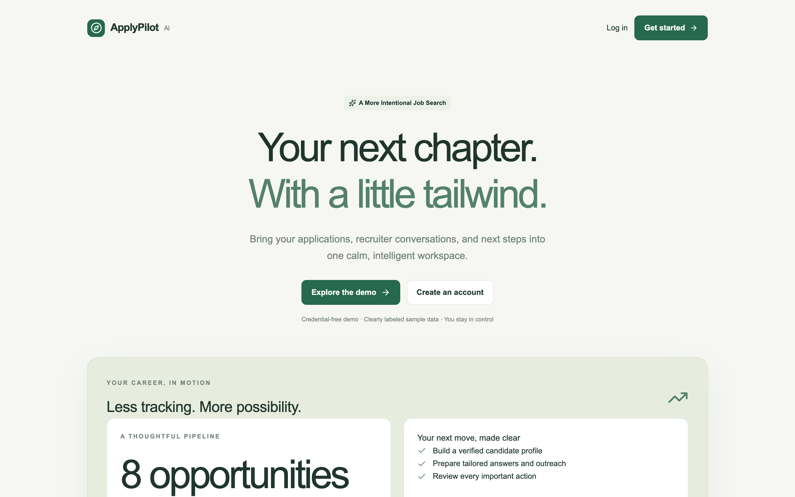
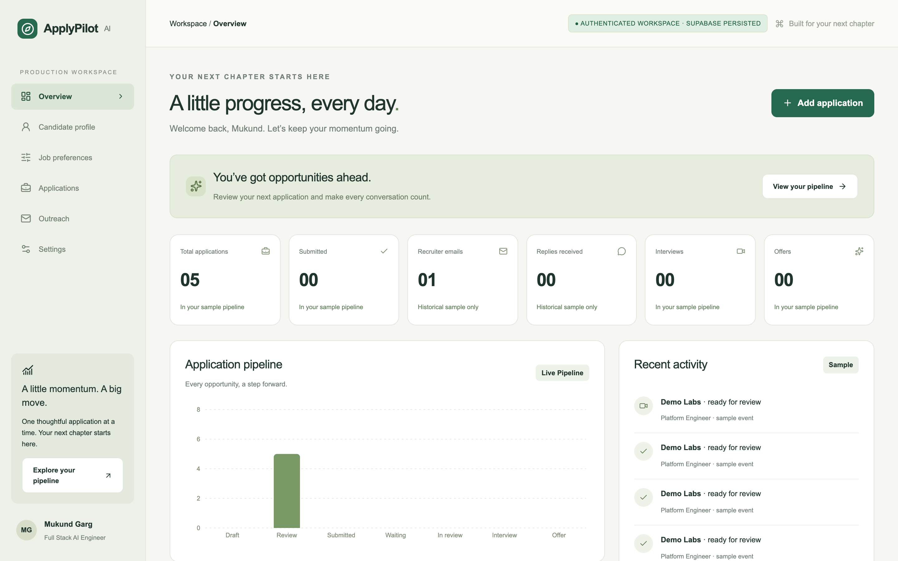
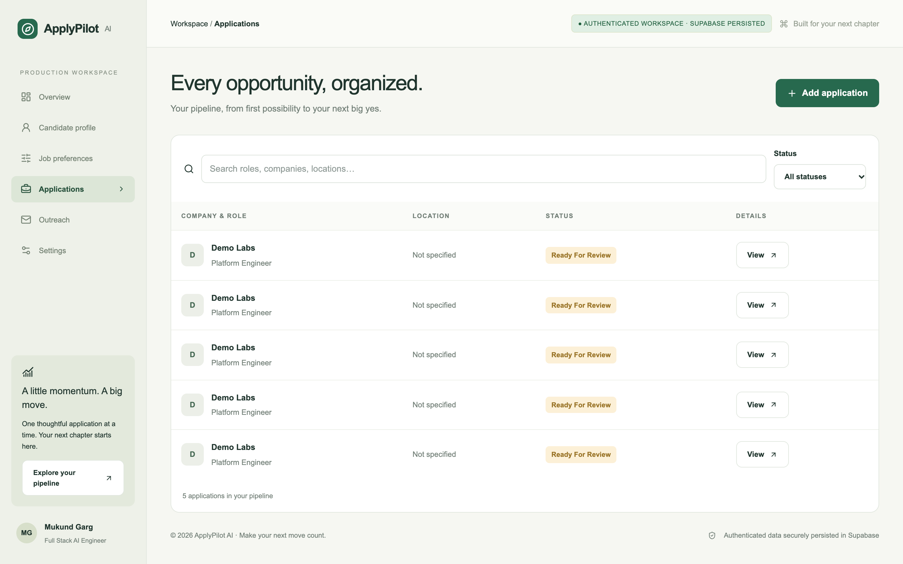
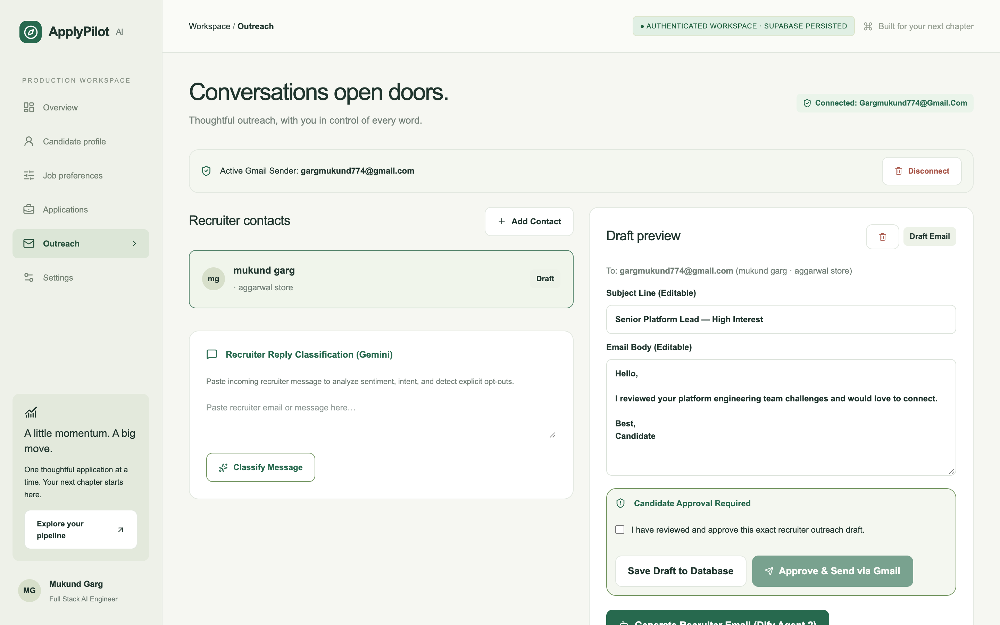
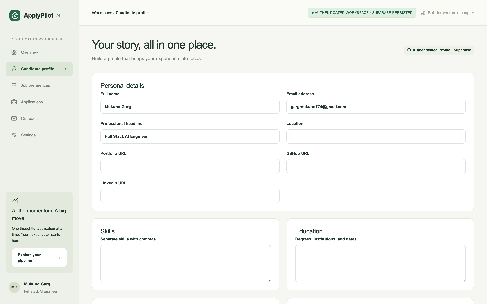

# ApplyPilot AI

### Your next chapter. With a little tailwind.

**An intelligent, human-supervised workspace for applications, candidate profiles, and recruiter outreach.**

   

[Product overview](#overview) · [Screenshots](#product-preview) · [Features](#features-in-depth) · [Architecture](#system-architecture) · [Run locally](#run-locally) · [Demo walkthrough](#demo-walkthrough)

---

## Overview

ApplyPilot AI is a full-stack career workspace that helps students, graduates, and early-career professionals manage the often disconnected process of applying for internships and jobs. It combines structured candidate information, AI-assisted job analysis, application response preparation, personalized recruiter outreach, and application tracking.

The underlying idea is straightforward: **information entered once should support more than one stage of the job search**. A candidate profile can inform role analysis, form preparation, and outreach instead of being recreated for each application.

ApplyPilot uses external LLM-powered capabilities through specialized application workflows. It does **not** claim to train its own foundational model. Generated information is intended for **candidate review**, not blind submission.

> [!IMPORTANT]
> **AI prepares; the candidate decides.** ApplyPilot is not an autonomous bulk-application bot. External application submission and recruiter communication remain subject to user review and the relevant service rules.

## Product preview

These images were captured from the running website. Some authenticated screenshots contain test/demo data; private identifiers have been cropped or redacted. They show the product interface, **not proof of real-world job offers or outreach delivery**.

### The landing experience

### The candidate workspace

<strong>Explore more real product screens — applications, outreach, and profile</strong>

#### Application pipeline

#### Recruiter outreach and editable email draft

#### Candidate profile

## The problem being solved

Job applications usually span different portals, CV files, spreadsheets, emails, and reminders. The resulting overhead is real even before a candidate submits a single application:

| Repetitive activity | Why it becomes difficult | What ApplyPilot connects |
| --- | --- | --- |
| Entering background repeatedly | Skills, education and experience must be rewritten | A reusable, editable candidate profile |
| Comparing a role to a resume | Requirements are long and sometimes ambiguous | Structured job-fit analysis |
| Answering screening questions | Answers need both personalization and factual accuracy | Evidence-aware response suggestions |
| Writing recruiter messages | Outreach must be relevant and respectful | Contact-aware editable email drafts |
| Tracking applications | Updates are distributed across multiple tools | One application pipeline with history |
| Remembering follow-ups | Important next steps are easily lost | Follow-up scheduling records |

The product is meant to reduce coordination work while preserving the candidate's judgment about what to apply for, what qualifications to claim, and whom to contact.

## How the experience works

~~~mermaid
flowchart LR
    A[Candidate profile] --> B[Resume understanding]
    B --> C[Role analysis]
    C --> D[Application preparation]
    D --> E[Human review]
    E --> F[Recruiter outreach draft]
    F --> G[Edit and save]
    G --> H[Approval and Gmail integration]
    E --> I[Application tracker]
    H --> I
~~~

**A concrete example:** A student uploads a PDF resume, reviews extracted skills and projects, adds a software engineering opportunity, analyzes its requirements, prepares answers for screening questions, and creates a recruiter contact. ApplyPilot drafts an email using that context. The student edits the subject and body, saves the draft, and can later retrieve it from their authenticated workspace. The application records status updates and follow-up plans separately from any actual external submission.

## Features in depth

### 1. Profile and resume intelligence

The candidate profile stores editable qualifications, projects, education, work experience, and preferences. In authenticated mode, a PDF resume can be uploaded to a **private Supabase Storage** bucket (up to **10 MiB**) and analyzed into structured details. The candidate reviews the extracted information before using it in other workflows.

This separation matters: resume parsing is fallible, so an AI-generated field should not automatically become an asserted qualification.

### 2. Opportunity analysis and job fit

For a provided job description, the job analysis workflow compares requirements with the candidate's available evidence. It can produce a match assessment, identified matches, missing or unverified skills, and contextual role insights. These are guidance for preparing an application—not a prediction of interview or hiring success.

### 3. Application intelligence and form assistance

The application preparation workflow helps map existing candidate data to requested form fields and draft screening responses grounded in the profile. The **review-and-copy** interface makes suggested answers easy to inspect and transfer to supported external application forms.

ApplyPilot does not universally fill or submit third-party job forms, bypass CAPTCHA, or circumvent portal restrictions.

### 4. Application tracking and history

Candidates can organize opportunities by role, company, and stage. The application stores transitions in PostgreSQL, and database-triggered events preserve the application's status history. Examples include draft, ready for review, submitted, awaiting response, interview, and closed outcomes.

Updating a status in the tracker **does not** itself transmit a job application to an employer.

### 5. Recruiter contact management

The outreach workspace keeps user-owned recruiter contacts, linked campaigns, and associated draft information in one place. Candidate and recruiter context can be used to compose relevant professional outreach rather than a generic message.

### 6. Personalized recruiter outreach

The outreach intelligence workflow prepares suggested subject lines and message bodies. Users can edit drafts, save them to the database, and return to review the saved content. The website includes contact suppression and stop recommendations to help prevent unwanted further communication.

### 7. Gmail OAuth and user-controlled sending

Authenticated users can connect Gmail through OAuth. The send pipeline checks account ownership, recipient matching, contact suppression, approval records, content fingerprints, and stable message-operation identity. Uncertain Gmail outcomes require reconciliation instead of blind retries.

A **Connected** indicator only confirms account authorization. Gmail API acceptance is distinct from confirmed inbox delivery or recipient engagement. Public deployment and real sending require careful operational validation.

### 8. Follow-up planning and reply interpretation

The project includes follow-up schedule data, approval states, and business-day calculations. Reply classification can analyze message text provided to the application to identify interest, rejection, and possible opt-outs.

These features do **not** imply that an always-running inbox monitor or autonomous follow-up sender is already deployed.

## The intelligence layer

Instead of relying on a single unstructured text generator, ApplyPilot routes tasks into distinct application workflows:

| Intelligence component | Context consumed | Output for user review |
| --- | --- | --- |
| **Resume Intelligence** | PDF resume | Structured candidate details |
| **Job Matching** | Job description + candidate information | Requirement matches and missing skills |
| **Application Intelligence** | Profile + form questions | Suggested field mappings and answers |
| **Recruiter Outreach Intelligence** | Candidate + contact context | Personalized editable email draft |
| **Reply Classification** | Provided recruiter message | Interest / opt-out / other intent signals |

Inputs and structured outputs use typed schemas; the router coordinates the relevant service, and execution metadata can be audited without putting raw private documents in those execution records. The practical innovation is in **integrating these capabilities into a coherent candidate workflow**, not developing a foundational LLM from scratch.

## System architecture

~~~mermaid
flowchart TD
    U[Candidate browser] --> FE[Next.js + React workspace]
    FE --> API[Authenticated Next.js API routes]
    API --> DB[Supabase Auth and PostgreSQL RLS]
    API --> AI[LLM task router]
    AI --> RE[Resume and role intelligence]
    AI --> AE[Application intelligence]
    AI --> OE[Outreach intelligence]
    RE --> HR[Structured output + human review]
    AE --> HR
    OE --> HR
    HR --> DB
    HR --> GM[Gmail OAuth and approved-send workflow]
    DB --> FE
~~~

### Technology stack

| Layer | Technology |
| --- | --- |
| Frontend | **Next.js 16, React 19, TypeScript, Tailwind CSS 4** |
| Forms and visuals | React Hook Form, Lucide icons, Recharts |
| Backend | Next.js App Router API routes, TypeScript services, Zod |
| AI integration | LLM-powered extraction, task routing, structured validation |
| Persistence | **Supabase PostgreSQL, Auth, Row Level Security** |
| Document storage | Private Supabase Storage, PDF parsing |
| Communication | Gmail API, Google OAuth 2.0, encrypted token storage |
| Testing | Node.js tests, Playwright, ESLint, TypeScript |
| Deployment | Vercel configuration prepared; public deployment not independently verified |

### Database design

| Table | Role |
| --- | --- |
| `profiles` | Candidate profile |
| `candidate_preferences` | Saved preferences |
| `resumes` | Private resume metadata |
| `job_applications` | Application records and status |
| `application_events` | Database-generated stage history |
| `recruiter_contacts` | User-owned recruiter contacts |
| `outreach_campaigns` | Outreach links to contacts and applications |
| `email_messages` | Drafts, approval data, Gmail identifiers |
| `followup_schedules` | Planned follow-up records |
| `agent_runs` | Safe intelligence execution metadata |
| `gmail_oauth_connections` | Encrypted account-connection data |

The schema uses ownership checks, Row Level Security, private file storage, and relationships designed to prevent cross-user records from being linked. See [SCHEMA.md](docs/SCHEMA.md) and [ARCHITECTURE.md](docs/ARCHITECTURE.md) for implementation details.

## Demo and authenticated modes

| Behavior | Demo mode | Authenticated mode |
| --- | --- | --- |
| Login | Not required | Required |
| Data | Fictional fixtures | User-scoped Supabase records |
| Local state | Browser session | Database persistence |
| AI output | Deterministic mock responses | Configured AI integrations |
| Resume selection | Metadata preview | Private file upload |
| Gmail sending | Disabled | Configured, approved send path |
| Third-party application submission | Never automatic | Never automatic |

> [!NOTE]
> Demo mode provides a useful tour without credentials. Sample metrics and mock responses are clearly simulated, not evidence of real job applications or recruiter activity.

## Demo walkthrough

The project includes a [five-minute demonstration script](docs/DEMO_SCRIPT.md). A short video has **not** yet been recorded or published; this README deliberately does not show a dead "Watch video" button or fabricate a video link.

**Suggested 90-second walkthrough:** landing page → dashboard → profile → application analysis → application response preparation → fictional recruiter contact → editable outreach draft → save and reload → approval controls.

When a genuine public video is available, add its URL here with a linked thumbnail using `assets/readme/homepage.png`.

## Run locally

**Prerequisites:** Node.js **22+**, npm. A Supabase project and external credentials are **not needed** for the explicitly labeled demo mode.

~~~bash
git clone https://github.com/MukundGarg/outreach.git
cd outreach
npm ci
cp .env.example .env.local
npm run dev
~~~

Open **http://localhost:3000**.

### Demo mode (no external credentials)

~~~dotenv
NEXT_PUBLIC_DEMO_MODE=true
~~~

Sample information remains in browser session state; no external Gmail transmissions or third-party application submissions occur.

### Authenticated mode

1. Create a Supabase project and apply the SQL migrations in `supabase/migrations/` in order.
2. Configure email/password authentication and your callback URL.
3. Set the public Supabase project values and configure the private AI services described in [`.env.example`](.env.example).
4. Set `NEXT_PUBLIC_DEMO_MODE=false`, restart the application and log in.
5. For Gmail, follow the [OAuth setup guide](docs/GMAIL_SETUP.md) and configure its redirect URI and server-side token-encryption key.

Never commit `.env.local`, test passwords, resume files, OAuth tokens, or provider keys. Previously exposed credentials require rotation even if they have been removed from the current source tree.

## Testing and engineering progress

~~~bash
npm run typecheck
npm run lint
npm test
npm run build
npx playwright install chromium
npm run test:e2e
~~~

The latest development handoff reported **38 passing Node-based tests, 6 passing browser tests, successful TypeScript and lint checks, and a successful production build**. These are development test results, not independent security certification or proof of successful real email delivery.

The browser suite covers navigation, candidate information, draft persistence, responsive layout, and unauthenticated API boundaries. Authenticated tests require dedicated test-account credentials configured through local environment variables.

## Security and implementation boundaries

- **Human review:** Resume extraction, application answers and outreach text are editable.
- **Account isolation:** Database operations are authenticated and backed by RLS policies.
- **Private files:** Resumes use a private storage bucket.
- **Gmail controls:** OAuth authorization, suppression checks, approval records, and transmission state safeguards.
- **Application submission:** The product prepares answers; it does not universally submit applications on third-party websites.
- **Scheduling:** Follow-up planning exists, but an autonomous background sender is not verified.
- **Production readiness:** Credential rotation, production OAuth setup, controlled live-send testing, and operational safeguards remain important.

## Repository layout

~~~text
src/app/               Pages and API routes
src/components/        Candidate workspace UI
src/services/          AI routing, application, Gmail and scheduling services
src/lib/               Schemas, domain rules, mock data
supabase/migrations/   SQL schema and RLS policies
tests/                 Unit and integration-oriented tests
tests/browser/         Playwright browser tests
docs/                  Architecture, deployment and demo documentation
~~~

**More details:** [Architecture](docs/ARCHITECTURE.md) · [Database schema](docs/SCHEMA.md) · [Gmail setup](docs/GMAIL_SETUP.md) · [Deployment](docs/DEPLOYMENT.md) · [Demo script](docs/DEMO_SCRIPT.md)

---

**A calmer way to navigate the next opportunity.**

*ApplyPilot AI — intelligent assistance, with the candidate in control.*

